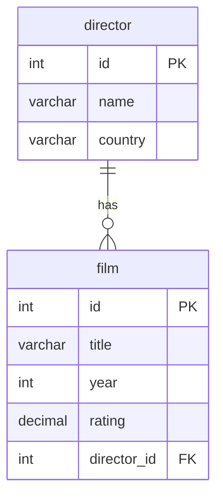

# 3-10 SQL in the terminal: two tables, a foreign key and a JOIN

You learn the SQL you need for the rest of the course, typed by hand in the MariaDB client: create tables, insert
rows, read, change and remove them, and join two tables that belong together. Then you save it all in a file,
`create.sql`, that builds the database from scratch with one command.

The example is a small film database: directors and the films they made. The same shape comes back in your to-do list
(categories and tasks, the optional 3-40) and in Assignment 1 (suppliers and products).

You need MariaDB running from 3-05. When you are done, your repo has:

```
practice/3-10/
├── create.sql      drops, creates and fills the tables
└── join.sql        a query that joins the tables
```

## Background: tables, keys and SQL

A table has columns, each with a type, and rows. The *primary key* is a column with a value that is unique for each
row, most often an `id` that the database numbers by itself (`AUTO_INCREMENT`). A *foreign key* is a column that
points out a row in another table by its id:

```text
director                        film
id  name            country     id  title               year  rating  director_id
1   Hayao Miyazaki  Japan  <──  1   Spirited Away       2001  8.6     1
                           <──  2   My Neighbor Totoro  1988  8.1     1
2   Greta Gerwig    USA    <──  3   Lady Bird           2017  7.4     2
```

SQL is the language you talk to the database in. The statements fall in two groups:

| Group | Statements | Does |
|---|---|---|
| Define the tables | `CREATE TABLE`, `DROP TABLE`, `ALTER TABLE` | What the tables and columns are |
| Work with the rows | `INSERT`, `SELECT`, `UPDATE`, `DELETE` | Add, read, change and remove rows (CRUD) |

Each statement ends with `;`. SQL keywords are written in capitals by convention, but the client accepts both.

## 1. A database for the films

Log in as the user `student` from 3-05, without a database this time, and type the password `P@ssw0rd`:

```bash
mariadb -u student -p
```

If Git Bash shows no prompt, put `winpty` first, as in 3-05. Create the database and choose it:

```sql
CREATE DATABASE film;
USE film;
```

The prompt changes to `MariaDB [film]>`. You stay logged in through steps 1 to 6.

## 2. The first table

Create the table of directors:

```sql
CREATE TABLE director (
  id INT AUTO_INCREMENT PRIMARY KEY,
  name VARCHAR(80) NOT NULL,
  country VARCHAR(40)
);
```

- `INT AUTO_INCREMENT PRIMARY KEY`: a whole number that the database sets to 1, 2, 3 ... for each new row.
- `VARCHAR(80)`: text of at most 80 characters. `NOT NULL` means the column must have a value.

Look at what you made:

```sql
SHOW TABLES;
DESCRIBE director;
```

## 3. Insert and read rows

Insert three directors. You leave out `id`, so the database sets it:

```sql
INSERT INTO director (name, country) VALUES
  ('Hayao Miyazaki', 'Japan'),
  ('Greta Gerwig', 'USA'),
  ('Ingmar Bergman', 'Sweden');
```

Read them back, first all columns, then some:

```sql
SELECT * FROM director;
SELECT name, country FROM director;
```

`WHERE` picks rows, `ORDER BY` sorts them:

```sql
SELECT * FROM director WHERE country = 'Sweden';
SELECT * FROM director ORDER BY name;
SELECT * FROM director WHERE name LIKE '%ar%';
```

`LIKE` compares with a pattern, where `%` is any text. Text is in single quotes in SQL.

## 4. A table with a foreign key

Each film is made by a director, so the table `film` has a column `director_id` that points at `director.id`:

```sql
CREATE TABLE film (
  id INT AUTO_INCREMENT PRIMARY KEY,
  title VARCHAR(80) NOT NULL,
  year INT,
  rating DECIMAL(3, 1),
  director_id INT NOT NULL,
  FOREIGN KEY (director_id) REFERENCES director (id)
);
```

`DECIMAL(3, 1)` is a number with three digits, one of them after the point, like `8.6`. The two tables, drawn as an
ER diagram (entity relationship): `PK` is the primary key, `FK` the foreign key, and the line says that one director
has zero or more films:



Insert the films:

```sql
INSERT INTO film (title, year, rating, director_id) VALUES
  ('Spirited Away', 2001, 8.6, 1),
  ('My Neighbor Totoro', 1988, 8.1, 1),
  ('Lady Bird', 2017, 7.4, 2),
  ('Little Women', 2019, 7.8, 2),
  ('The Seventh Seal', 1957, 8.1, 3),
  ('Wild Strawberries', 1957, 8.1, 3);
```

Now try a film by a director that does not exist:

```sql
INSERT INTO film (title, year, rating, director_id) VALUES ('Nobody made this', 2020, 5.0, 99);
```

```text
ERROR 1452 (23000): Cannot add or update a child row: a foreign key constraint fails ...
```

That is the foreign key at work: the database refuses a `director_id` that points at nothing.

## 5. Change and remove rows

`UPDATE` changes the rows that `WHERE` picks, and `DELETE` removes them:

```sql
UPDATE film SET rating = 8.7 WHERE id = 1;
SELECT * FROM film WHERE id = 1;

INSERT INTO film (title, year, rating, director_id) VALUES ('A film to remove', 2000, 1.0, 1);
DELETE FROM film WHERE title = 'A film to remove';
SELECT COUNT(*) FROM film;
```

`COUNT(*)` counts the rows: 6 again.

> **Always write the `WHERE`.** `UPDATE film SET rating = 1;` and `DELETE FROM film;` without it change or remove
> every row in the table, and there is no undo.

Try to remove a director who still has films:

```sql
DELETE FROM director WHERE id = 3;
```

```text
ERROR 1451 (23000): Cannot delete or update a parent row: a foreign key constraint fails ...
```

The foreign key protects the other way too: the films would point at nothing.

## 6. Join the tables

The table `film` has only the id of the director. To get the name too, join the two tables on the column they share:

```sql
SELECT film.title, film.year, director.name AS director
FROM film
JOIN director ON film.director_id = director.id
ORDER BY film.year, film.title;
```

`JOIN ... ON` puts each film row together with the director row whose `id` matches its `director_id`. `AS director`
names the column in the answer, and films from the same year are sorted by title. A `WHERE` gives the films of one
director:

```sql
SELECT film.title, director.name AS director
FROM film
JOIN director ON film.director_id = director.id
WHERE director.id = 1;
```

`GROUP BY` puts rows together, so you can count per group:

```sql
SELECT director.name, COUNT(film.id) AS films
FROM director
JOIN film ON film.director_id = director.id
GROUP BY director.id;
```

Log out with `exit`.

## 7. All of it in a file

What you typed is lost if the database is removed, and it is hard to share. So you save it in a file that builds the
tables from scratch. Create `practice/3-10/create.sql` with the two `CREATE TABLE` and the two `INSERT` from steps
2 to 4, and start the file with:

```sql
DROP TABLE IF EXISTS film;
DROP TABLE IF EXISTS director;
```

The film table goes first, since its foreign key points at `director`. With the `DROP` lines the file can be loaded
again and again, and gives you the same data each time.

The file creates the tables, not the database: you load it *into* the database `film`, which you created once in
step 1. Keep the two apart. The database (and the user, from 3-05) is set up once; the tables are created again
each time you want to start over. A statement that sets up something only once is written so it can be run again
without an error:

```sql
CREATE DATABASE IF NOT EXISTS film;
```

In 3-40 (optional) those lines get a file of their own, `setup.sql`, next to `create.sql`.

<details>
<summary>A solution</summary>

```sql
DROP TABLE IF EXISTS film;
DROP TABLE IF EXISTS director;

CREATE TABLE director (
  id INT AUTO_INCREMENT PRIMARY KEY,
  name VARCHAR(80) NOT NULL,
  country VARCHAR(40)
);

CREATE TABLE film (
  id INT AUTO_INCREMENT PRIMARY KEY,
  title VARCHAR(80) NOT NULL,
  year INT,
  rating DECIMAL(3, 1),
  director_id INT NOT NULL,
  FOREIGN KEY (director_id) REFERENCES director (id)
);

INSERT INTO director (name, country) VALUES
  ('Hayao Miyazaki', 'Japan'),
  ('Greta Gerwig', 'USA'),
  ('Ingmar Bergman', 'Sweden');

INSERT INTO film (title, year, rating, director_id) VALUES
  ('Spirited Away', 2001, 8.6, 1),
  ('My Neighbor Totoro', 1988, 8.1, 1),
  ('Lady Bird', 2017, 7.4, 2),
  ('Little Women', 2019, 7.8, 2),
  ('The Seventh Seal', 1957, 8.1, 3),
  ('Wild Strawberries', 1957, 8.1, 3);
```

</details>

Load the file from the root of your repo. This time the client reads the file instead of the keyboard, so the
password is given with `-p` directly before it, with no space:

```bash
mariadb -u student -pP@ssw0rd film < practice/3-10/create.sql
```

No output means it went well. The `<` is your terminal's: it sends the file to the command, so the path is relative
to where you stand.

## 8. A query in a file

Save the first JOIN from step 6 in `practice/3-10/join.sql` and run it the same way. The flag `-t` prints a table, as
in the client:

```bash
mariadb -u student -pP@ssw0rd film -t < practice/3-10/join.sql
```

### 8.1 The films with their directors

```text
+--------------------+------+----------------+
| title              | year | director       |
+--------------------+------+----------------+
| The Seventh Seal   | 1957 | Ingmar Bergman |
| Wild Strawberries  | 1957 | Ingmar Bergman |
| My Neighbor Totoro | 1988 | Hayao Miyazaki |
| Spirited Away      | 2001 | Hayao Miyazaki |
| Lady Bird          | 2017 | Greta Gerwig   |
| Little Women       | 2019 | Greta Gerwig   |
+--------------------+------+----------------+
```

Load `create.sql` again and run `join.sql` once more: the same answer, since the file starts over each time.

> **The password on the command line.** `-pP@ssw0rd` is handy here, but the password ends up in your shell history.
> That is fine for a database on your own computer that only you can reach, never for a real one.

## Check and commit

```bash
npm run check
git add practice/3-10
git commit -m "3-10 SQL: two tables, a foreign key and a JOIN"
```

If you have a remote of your own, push with `git push`.

### Verify

- [ ] `create.sql` can be loaded twice in a row without errors, and gives 3 directors and 6 films.
- [ ] `join.sql` prints the films with the name of their director.
- [ ] You can say what a primary key and a foreign key are, and what the foreign key stopped in steps 4 and 5.
- [ ] You can write a `SELECT` with `WHERE` and `ORDER BY`, an `UPDATE` and a `DELETE`, and say why the `WHERE`
      matters.

<details>
<summary><code>ERROR 1005 (HY000): Can't create table ... Foreign key constraint is incorrectly formed</code></summary>

The foreign key points at a table that does not exist yet, or at a column of another type. Create `director` before
`film`, and give `director_id` the same type as `director.id`, `INT`.

</details>

<details>
<summary><code>ERROR 1050 (42S01): Table 'director' already exists</code></summary>

The table is there from an earlier try. In the file, the `DROP TABLE IF EXISTS` lines at the top take care of it. By
hand, run `DROP TABLE film;` and `DROP TABLE director;` first, in that order.

</details>

<details>
<summary><code>ERROR 1049 (42000): Unknown database 'film'</code></summary>

Create it first, step 1: log in and run `CREATE DATABASE film;`.

</details>

<details>
<summary>The client waits with <code>-></code> and does nothing</summary>

The statement has no `;` yet, so the client waits for the rest. Type `;` and press Enter. If you are inside a quote
that is not closed, type `'` first, then `;`.

</details>

## Read more

- SQL statements in MariaDB, `CREATE TABLE`, `SELECT`, `INSERT`, `UPDATE`, `DELETE`:
  https://mariadb.com/docs/server/reference/sql-statements
- `JOIN` with examples: https://mariadb.com/docs/server/reference/sql-statements/data-manipulation/selecting-data/joins-subqueries/joins/joining-tables-with-join-clauses-guide
- Foreign keys: https://mariadb.com/docs/server/ha-and-performance/optimization-and-tuning/optimization-and-indexes/foreign-keys
- The SQL tutorial at W3Schools, good for trying statements one by one: https://www.w3schools.com/sql/
