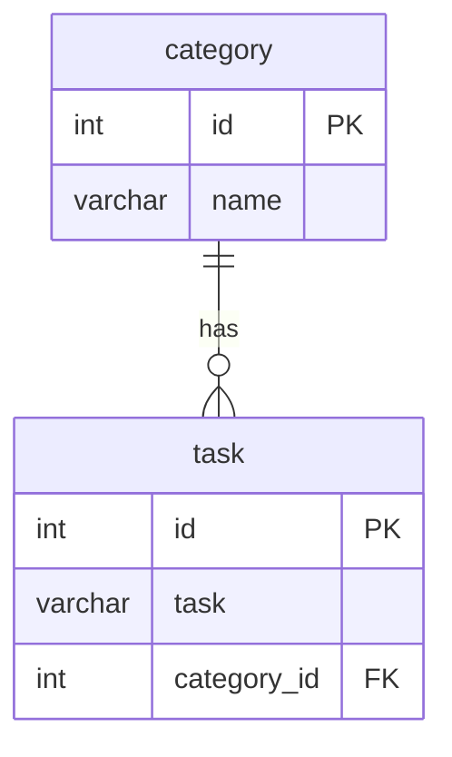

# 3-40 The to-do list in MariaDB: tables, a model and a terminal program (optional)

*Optional.* This exercise and 4-40 move the to-do app in `src/` to the database, with the same structure as Assignment 1
and 2: the SQL files in `db/`, a model, routes and tests. It is good practice before the assignments. On a faster track,
skip both: start on the terminal program of Assignment 1 after 3-35; nothing later needs them.

In 2-50 your to-do list became a JSON API, with the tasks in memory. In this exercise the tasks move to MariaDB. You
write the tables, a model with the SQL queries as `async` functions, and a terminal program with commands such as
`task list` and `task show 2`, built as in 3-35. The API stays as it is this week, with the tasks in memory; in 4-40
the routes get their tasks from the database too, through the functions you write here.

This is what happens, step by step:

- You create the database `todo`, and write `db/create.sql` with two tables: the categories, and the tasks that each
  belong to a category. You look at them with a JOIN.
- You give the app the settings of the database in `.env`, and a connection pool, as in 3-30.
- You add the tests of the model, see them fail, and write the queries in `src/model/task.js` until they pass.
- You write the commands of the terminal program, which call the model, and run them from a file.

As in 2-50 the tests and the output to compare with are given, and you write the code. The solution is shown in the
Friday session of week 4. It is the same shape as the terminal program and `create.sql` of Assignment 1.

You need 2-50, 3-10, 3-30 and 3-35 done, and MariaDB running. When you are done, these files are new or changed:

```
.env.example            the settings, without your password
.env                    your settings, not committed
package.json            a script for the terminal program
db/
├── setup.sql           the database and its user, run once as root
└── create.sql          the tables and the data
src/
├── database.js         the connection pool, given
├── cli.js              the terminal program, given
├── commands.txt        commands to try the program with, given
├── commands/
│   ├── category.js     the command group category
│   └── task.js         the command group task
└── model/
    ├── task.js         the tasks in the database, as async functions
    └── task.test.js    the tests of task.js, given
```

`src/model/todo.js` from 2-50 and the routes do not change this week.

## Background: two tables

A task belongs to a category, such as Home or Shopping. The categories get a table of their own, and each task points
to its category with a foreign key, as `film` points to `director` in 3-10:



The model, `src/model/task.js`, is the only part of the app that knows the SQL. The commands now, and the routes in
4-40, call its functions and never write a query of their own.

## 1. The database and the tables: `setup.sql` and `create.sql`

The app has two SQL files, kept apart as in 3-10: `db/setup.sql` sets up the database and the user once, as root,
and `db/create.sql` creates the tables, as the user, again and again.

Create `db/setup.sql`:

```sql
--
-- The database of the to-do app and its user. Run once, as root.
--
CREATE DATABASE IF NOT EXISTS todo;

CREATE USER IF NOT EXISTS 'student'@'%' IDENTIFIED BY 'P@ssw0rd';
CREATE USER IF NOT EXISTS 'student'@'localhost' IDENTIFIED BY 'P@ssw0rd';
GRANT ALL PRIVILEGES ON *.* TO 'student'@'%';
GRANT ALL PRIVILEGES ON *.* TO 'student'@'localhost';
```

You have the user from 3-05 already, so `CREATE USER IF NOT EXISTS` does nothing on your computer; the file works on a
computer where the user is missing too. Run it as root, from the root of your repo, the way you logged in as root in
3-05:

```bash
mariadb -u root -p < db/setup.sql      # Windows
sudo mariadb < db/setup.sql            # macOS and Linux
```

Then create `db/create.sql`. It drops and creates the tables, and fills them, so it can be loaded again to start over,
as `create.sql` in 3-10:

| Table | Columns |
|---|---|
| `category` | `id` (primary key, `AUTO_INCREMENT`), `name` (text, not null) |
| `task` | `id` (primary key, `AUTO_INCREMENT`), `task` (text, not null), `category_id` (not null, a foreign key to `category`) |

The data:

| Category | Tasks |
|---|---|
| 1 Home | 1 Wash clothes, 4 Do the dishes |
| 2 Shopping | 2 Buy milk, 5 Buy bread |
| 3 Family | 3 Call grandma |

Insert the rows in the order of their ids, and the database gives them those ids.

Hints:

- Look at `practice/3-10/create.sql`: `director` and `film` have the same shape as `category` and `task`.
- Drop `task` before `category`: the foreign key does not let you drop a table that another table points to.

<details>
<summary>A solution: drop the tables</summary>

```sql
DROP TABLE IF EXISTS task;
DROP TABLE IF EXISTS category;
```

</details>

<details>
<summary>A solution: create the tables</summary>

```sql
CREATE TABLE category (
  id INT AUTO_INCREMENT PRIMARY KEY,
  name VARCHAR(40) NOT NULL
);

CREATE TABLE task (
  id INT AUTO_INCREMENT PRIMARY KEY,
  task VARCHAR(200) NOT NULL,
  category_id INT NOT NULL,
  FOREIGN KEY (category_id) REFERENCES category (id)
);
```

</details>

<details>
<summary>A solution: insert the rows</summary>

```sql
INSERT INTO category (name) VALUES
  ('Home'),
  ('Shopping'),
  ('Family');

INSERT INTO task (task, category_id) VALUES
  ('Wash clothes', 1),
  ('Buy milk', 2),
  ('Call grandma', 3),
  ('Do the dishes', 1),
  ('Buy bread', 2);
```

</details>

Load the file, and look at the tasks with their categories:

```bash
mariadb -u student -pP@ssw0rd todo < db/create.sql
mariadb -u student -pP@ssw0rd todo -t \
  -e "SELECT task.id, task.task, category.name FROM task JOIN category ON task.category_id = category.id;"
```

### 1.1 The tasks and their categories

```text
+----+---------------+----------+
| id | task          | name     |
+----+---------------+----------+
|  1 | Wash clothes  | Home     |
|  2 | Buy milk      | Shopping |
|  3 | Call grandma  | Family   |
|  4 | Do the dishes | Home     |
|  5 | Buy bread     | Shopping |
+----+---------------+----------+
```

The rows may come in another order, since the query has no `ORDER BY`. Load the file twice in a row: no errors, the
same answer.

## 2. The settings and the connection

The app reads its settings from `.env` in the root of your repo: `npm run dev` already starts it with
`--env-file-if-exists=.env`. Create `.env.example` in the root, as in 3-30 but with the database `todo`:

```
DB_HOST=127.0.0.1
DB_PORT=3306
DB_USER=student
DB_PASSWORD=your-password
DB_DATABASE=todo
```

Copy it to `.env` and put your password in the copy:

```bash
cp .env.example .env
```

Create `src/database.js`; it is given, the same as `practice/3-30/database.js`, so copy it from there:

<details>
<summary>The code of <code>src/database.js</code></summary>

```js
import mysql from 'mysql2/promise'

// One pool for the whole app. The values come from .env (node --env-file).
const pool = mysql.createPool({
  host: process.env.DB_HOST,
  port: Number(process.env.DB_PORT ?? 3306),
  user: process.env.DB_USER,
  password: process.env.DB_PASSWORD,
  database: process.env.DB_DATABASE,
  // DECIMAL columns come back as numbers, not strings
  decimalNumbers: true,
})

export default pool
```

</details>

## 3. The model: tests first

In this step the tests are given, and you write the code. It goes in three steps:

1. **The tests (3.1).** You copy `task.test.js` as it is. It says what each function of the model must give back.
2. **See them fail (3.2).** You create `task.js` with the functions empty, run the tests, and see them fail: they
   test something you have not written yet.
3. **Write the functions (3.3).** You fill in the functions one by one, and run the tests after each, until all pass.

The model has these functions. Each one is `async`, uses the pool from `database.js`, and has a `?` for every value,
as `film.js` in 3-30:

| Function | Gives |
|---|---|
| `getCategories()` | all categories, `{ id, name }`, sorted by id |
| `getTasksWithCategory()` | all tasks, `{ id, task, category }` where `category` is the name of the category (a JOIN), sorted by id |
| `getTask(id)` | the task `{ id, task, category_id }`, or `undefined` |
| `getTaskCategory(id)` | the category `{ id, name }` of the task, or `undefined` when there is no such task |
| `addTask({ task, category_id })` | the id of the new task |

### 3.1 The tests

Create `src/model/task.test.js`, which is given:

```js
import { describe, test, after } from 'node:test'
import assert from 'node:assert/strict'

// The tests need the database. They read the settings from .env themselves, and are skipped, with the reason, when
// the file is missing or MariaDB does not answer: then `npm run check` passes on a computer without the database.
// They only read, so they do not change the data.
let skip = false
try {
  process.loadEnvFile(new URL('../../.env', import.meta.url))
} catch {
  skip = 'no database: .env is missing'
}

// Imported after the settings are read, since database.js creates the pool from process.env when it is imported
const { default: pool } = await import('../database.js')
const { getCategories, getTasksWithCategory, getTask, getTaskCategory } = await import('./task.js')

if (!skip) {
  try {
    await pool.query('SELECT 1')
  } catch (error) {
    skip = `no database: MariaDB does not answer (${error.code ?? error.message})`
  }
}

after(() => pool.end())

describe('the tasks in MariaDB', { skip }, () => {
  test('getCategories gives all categories, sorted by id', async () => {
    assert.deepEqual(await getCategories(), [
      { id: 1, name: 'Home' },
      { id: 2, name: 'Shopping' },
      { id: 3, name: 'Family' },
    ])
  })

  test('getTasksWithCategory gives each task with the name of its category', async () => {
    const tasks = await getTasksWithCategory()
    assert.ok(tasks.length >= 5)
    assert.deepEqual(tasks[0], { id: 1, task: 'Wash clothes', category: 'Home' })
    assert.deepEqual(tasks[1], { id: 2, task: 'Buy milk', category: 'Shopping' })
  })

  test('getTask gives the task with that id, or undefined', async () => {
    assert.deepEqual(await getTask(2), { id: 2, task: 'Buy milk', category_id: 2 })
    assert.equal(await getTask(9999), undefined)
  })

  test('getTaskCategory gives the category of the task, or undefined', async () => {
    assert.deepEqual(await getTaskCategory(3), { id: 3, name: 'Family' })
    assert.equal(await getTaskCategory(9999), undefined)
  })
})
```

Three things in it are new:

- `npm test` has no `--env-file`, so the tests read `.env` themselves with `process.loadEnvFile()`.
- The tests are in a `describe()`, a group that can be skipped as one. When `.env` is missing or MariaDB does not
  answer, the group is skipped, and `npm test` still passes. The reason is on the line of the group, marked `﹣`:
  `﹣ the tasks in MariaDB # no database: .env is missing`. The summary at the end says `skipped 0`, since it
  counts the tests, not the groups.
- `database.js` creates the pool from `process.env` when it is imported. A normal `import` at the top runs before the
  file is read, so the modules are imported with `await import()` after it.

The tests need the data from `create.sql`, and do not change it. `addTask()` is tried with the terminal program
instead, in step 5.

### 3.2 See them fail

Create `src/model/task.js` with the functions, empty for now:

```js
import pool from '../database.js'

export async function getCategories() {
  // 1. All categories, sorted by id
}

export async function getTasksWithCategory() {
  // 2. All tasks with the name of their category, a JOIN, sorted by id
}

export async function getTask(id) {
  // 3. The task with the id, or undefined
}

export async function getTaskCategory(id) {
  // 4. The category of the task with the id, or undefined
}

export async function addTask({ task, category_id }) {
  // 5. Insert the task, and return its new id
}
```

Run the tests of the model, with MariaDB running:

```bash
npm test -- src/model/task.test.js
```

The four new tests fail. A failing test shows what it expected and what the function gave: `undefined`, for now.

### 3.3 Write the functions

Write the functions until the tests pass. Run only one of them by a part of its name, as in 2-50:
`npm test -- --test-name-pattern="getCategories" src/model/task.test.js`.

Hints:

- As in `film.js` in 3-30: `const [rows] = await pool.query(sql, values)`, and `return rows` for a list or
  `return rows[0]` for one row, which is `undefined` when there is none.
- Pick the columns by name, `SELECT id, task, category_id FROM task ...`, so the objects get the keys the tests want.
- `getTasksWithCategory()` renames the column of the category: `category.name AS category`.
- `getTaskCategory(id)` is one query: join `task` and `category`, pick the columns of `category`, and the row of the
  task with the id.
- `addTask()` gets the new id from the result of an `INSERT`, as `addFilm()` in 3-30.

## 4. The commands

Add a script for the terminal program to `package.json`, last in `"scripts"`, with a comma at the end of the line
before it:

```json
"cli": "node --env-file=.env src/cli.js"
```

Create `src/cli.js`. It is given, as `cli.js` in 3-35:

```js
import os from 'node:os'
import path from 'node:path'
import { CommandRegistry, TuiShell } from '@dbwebb/tui'
import { TaskCommands } from './commands/task.js'
import { CategoryCommands } from './commands/category.js'

const registry = new CommandRegistry()
registry.register('task', new TaskCommands())
registry.register('category', new CategoryCommands())

new TuiShell(registry, {
  welcomeMessage: 'The to-do list',
  historyFile: path.join(os.homedir(), '.dbwtui', 'todo_history'),
}).start()
```

Write the two command groups, `src/commands/category.js` and `src/commands/task.js`, as the groups in 3-35. They call
the functions in `src/model/task.js` and return the text below:

| Command | Prints | Or fails with |
|---|---|---|
| `category list` | one line per category: `1  Home` | |
| `task list` | one line per task: `2  Buy milk (Shopping)` | |
| `task show <id>` | `2  Buy milk, in Shopping` | `Task 42 not found`, or a usage message for an id that is not a whole number |
| `task add <task> <category_id>` | `Added task 6: Buy eggs` | a usage message without a task, or with a `category_id` that is not a whole number |

The columns in the lines are separated by two spaces. "Fails" means `return this.fail(...)`, as in 3-35. Each group
has `static descriptions` with a help text for each command.

<details>
<summary>A template for <code>src/commands/category.js</code></summary>

```js
import { BaseCommand } from '@dbwebb/tui'
import { getCategories } from '../model/task.js'

export class CategoryCommands extends BaseCommand {
  static descriptions = {
    list: 'list            All categories',
  }

  async list() {
    // Get the categories, and return one line per category
  }
}
```

</details>

<details>
<summary>A template for <code>src/commands/task.js</code></summary>

```js
import { BaseCommand } from '@dbwebb/tui'
import { getTasksWithCategory, getTask, getTaskCategory, addTask } from '../model/task.js'

// toId() from 3-35 goes here

export class TaskCommands extends BaseCommand {
  static descriptions = {
    list: 'list            All tasks, with their category',
    show: 'show <id>       One task',
    add: 'add ...         Add a task: <task> <category_id>',
  }

  async list() {
    // Get the tasks with their category, and return one line per task
  }

  async show(value) {
    // Check the id, get the task and its category, and return one line
  }

  async add(task, categoryId) {
    // Check the arguments, add the task, and return the line with its new id
  }
}
```

</details>

Hints:

- `toId()` from 3-35 checks the id from the command line. Put it in `commands/task.js`.
- `task show` needs two functions: `getTask(id)` for the task and `getTaskCategory(id)` for the name of its category.
- `task add` with a category that does not exist fails by itself: the foreign key stops the `INSERT`, `addTask()`
  throws the error, and the package prints it as a failure.

## 5. Try it

Start the program with `npm run cli`, try the commands and `help`, and quit with `q`.

Then try all the commands at once from a file, as in 3-35. Create `src/commands.txt` with these lines:

```text
# Commands to try the to-do list with, one per line
category list
task list
task show 2
task show 42
task show abc
task add "Buy eggs" 2
task show 6
```

Load the data again first, so the new task gets id 6, and let the program read the file:

```bash
mariadb -u student -pP@ssw0rd todo < db/create.sql
npm run cli --silent < src/commands.txt
```

`--silent` keeps npm from printing its own lines first.

### 5.1 The to-do list from the file

```text
> category list
1  Home
2  Shopping
3  Family

> task list
1  Wash clothes (Home)
2  Buy milk (Shopping)
3  Call grandma (Family)
4  Do the dishes (Home)
5  Buy bread (Shopping)

> task show 2
2  Buy milk, in Shopping

> task show 42
Task 42 not found

> task show abc
Usage: task show <id>, where id is a whole number

> task add "Buy eggs" 2
Added task 6: Buy eggs

> task show 6
6  Buy eggs, in Shopping

5 ok, 0 warn, 2 failed
```

Your usage message may have other words. The two failures are the ones on purpose, `42` and `abc`.

Load `create.sql` once more when you are done, so the tests and 4-40 start from the same data.

## Check and commit

```bash
npm run check
git status
git add .env.example package.json db src
git commit -m "3-40 The to-do list in MariaDB"
```

If `npm run check` says `Code style issues found`, run `npm run format` and look at the change with `git diff`.

Check in the output of `git status` that `.env` is not in the list. If you have a remote of your own, push with
`git push`.

### Verify

- [ ] `create.sql` can be loaded twice in a row, and gives the categories and tasks of step 1.
- [ ] `npm test -- src/model/task.test.js` passes with MariaDB running, and the group is skipped with the reason
  when it is stopped.
- [ ] `npm run cli --silent < src/commands.txt` prints what step 5 shows.
- [ ] All SQL is in `src/model/task.js`, and every value in it goes through a `?`.
- [ ] `npm run check` passes, and the API of 2-50 works as before with `npm run dev`.

<details>
<summary>The tests are skipped: <code>no database: .env is missing</code></summary>

There is no `.env` in the root of your repo. Copy `.env.example` to `.env` as in step 2, and put your password in it.

</details>

<details>
<summary>The tests are skipped with another reason, such as <code>ECONNREFUSED</code></summary>

The reason is the error from the database. See "The database" in [Troubleshooting](../doc/troubleshooting.md#the-database); the database `todo` is
created in step 1.

</details>

<details>
<summary><code>ERROR 1146 (42S02): Table 'todo.task' doesn't exist</code></summary>

`create.sql` has not been loaded into `todo`, or it stopped at an error further up. Load it again and read the first
error.

</details>

<details>
<summary>The task ids start at 6, or have gaps</summary>

`AUTO_INCREMENT` goes on counting after removed rows. `DROP TABLE` at the top of `create.sql` starts the count over;
check that the file drops `task` and `category` before it creates them, and load it again.

</details>

<details>
<summary>A test says the object has more keys, or other keys, than it expected</summary>

The query picks other columns than the test wants, for example `SELECT *` or `category.name` without `AS category`.
Name the columns in the `SELECT`, and compare with the table in step 3.

</details>

`ECONNREFUSED` or `Access denied` after a command: start the program with `npm run cli`, which gives `--env-file`, and
see "The database" in [Troubleshooting](../doc/troubleshooting.md#the-database).

## Challenge

`task add "Do it" 99` prints the long error from the foreign key. Check first that the category exists, and fail with
`Category 99 not found`. Add a command `category tasks <id>` that lists the tasks of one category.

## Read more

- 3-10, 3-30 and 3-35: the SQL, the queries with `mysql2` and the commands, for the film database.
- [Testing with Node.js](../doc/testing-with-node.md): running only some of the tests.
- `describe()` and skipping tests in `node:test`: https://nodejs.org/api/test.html#skipping-tests
- `process.loadEnvFile()`: https://nodejs.org/api/process.html#processloadenvfilepath
- `import()`, an import that runs when the code gets to it:
  https://developer.mozilla.org/en-US/docs/Web/JavaScript/Reference/Operators/import
- `@dbwebb/tui`: https://www.npmjs.com/package/@dbwebb/tui
